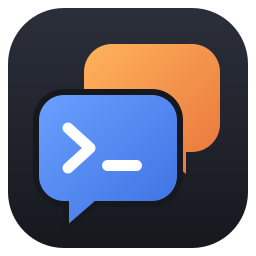
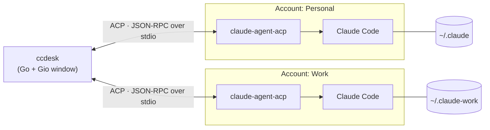

<div align="center">



# ccdesk

**A fast, native desktop app for Claude Code on Linux.**

No Electron, no browser engine: a single ~9 MB Go binary that talks to Claude Code
and gives it a proper window, with every conversation one click away, your work and personal
accounts side by side, and Claude's thinking streaming in as it happens.


</div>

---

## Contents

- [Why ccdesk](#why-ccdesk)
- [Features](#features)
- [How it works](#how-it-works)
- [Requirements](#requirements)
- [Installation](#installation)
- [Getting started](#getting-started)
- [Keyboard and mouse](#keyboard-and-mouse)
- [Accounts](#accounts)
- [Appearance](#appearance)
- [Configuration reference](#configuration-reference)
- [Troubleshooting](#troubleshooting)
- [Under the hood](#under-the-hood)
- [Development](#development)
- [Limitations](#limitations)
- [License](#license)

---

## Why ccdesk

Claude Code's terminal interface is excellent, but sometimes you want a window: proportional
fonts, a sidebar of past conversations, images you can paste and copy, text you can select and
quote. The existing GUI options are either editor plugins or Electron apps.

ccdesk is a small native client instead. It's written in Go with [Gio](https://gioui.org), draws
everything on the GPU, and starts instantly. Claude Code itself does all the agent work through
its official connector, so you keep your settings, `CLAUDE.md` files, skills, MCP servers,
permissions and history, exactly as they are in the terminal.

## Features

### Conversations
- **Every session, one list.** All your Claude Code sessions from every project folder,
  including ones started in the terminal, newest first, searchable by title or folder.
  Click to resume.
- **Live thinking.** Claude's reasoning streams in as it thinks, then stays readable above the
  answer ("▾ Thought for 12s"). Click the header to fold it.
- **A real status line.** What Claude is doing right now (*Thinking*, *Running: pytest -q*,
  *Writing*, *Waiting for your permission*), elapsed time and context size, updated every second.
- **Rendered Markdown.** Headings, lists, quotes, tables, inline `code` and code blocks.
- **Tool calls that stay out of the way.** One line each, with a status mark; click to see the
  command, its output, or a colored diff of a file edit.
- **Permission prompts as buttons.** Allow / Deny right in the conversation, plus a desktop
  notification when Claude needs you or finishes while the window is in the background.

### Reading and replying
- **Select anything.** Drag across paragraphs, lists and code; double-click a word, triple-click a
  paragraph. Selection starts even from the empty margins beside the text.
- **Rich copy.** Copied text carries formatting, so it pastes into Teams, email or Docs with bold,
  lists and code intact, and as clean text into a terminal.
- **Reply to a passage.** Right-click a selection → **Reply** quotes it into the message box as
  Markdown (`> …`) with the cursor ready below.

### Writing
- **Paste images** with Ctrl+V (screenshots or image files copied in a file manager), or **drag
  and drop** images and files onto the window. Click any image in a conversation to copy it.
- **Prompt suggestions.** After a turn, Claude's predicted next prompt appears greyed out in the
  message box; press → or Tab to take it.
- **Slash-command autocomplete** for every command and skill the session offers.
- **Session controls** under the message box: permission mode, model and effort.

### Accounts and looks
- **Several Claude accounts at once**, such as a personal Pro plan and a company Enterprise seat,
  each with its own login, history and look. With a single account, all of the account UI
  disappears.
- **Themes:** Auto (follows your desktop's light/dark setting), Light, Dark, and any accent color.
  On [Omarchy](https://omarchy.org) every installed Omarchy theme is available too, and
  "current" follows the system theme live.
- **`/login` and `/logout`** work from inside the app.

### Lightweight
- One ~9 MB binary. On the author's machine the app uses about 100 MB of memory, plus about
  80 MB for each account's connector process.

## How it works



ccdesk speaks the [Agent Client Protocol](https://agentclientprotocol.com) (ACP) to
[`claude-agent-acp`](https://github.com/agentclientprotocol/claude-agent-acp), the official
connector that runs Claude Code behind ACP clients such as Zed. ccdesk starts one connector per
account, each pointed at a different Claude config folder through `CLAUDE_CONFIG_DIR`, the same
mechanism as running `CLAUDE_CONFIG_DIR=~/.claude-work claude` in a terminal.

Everything that makes Claude Code what it is (tools, permissions, sessions, `CLAUDE.md`, skills,
MCP, hooks, models) happens in Claude Code. ccdesk is the window.

## Requirements

| | |
|---|---|
| **OS** | Linux with a **Wayland** compositor (developed on Hyprland; GNOME and KDE should work) |
| **Claude** | A Claude account that works with Claude Code (Pro, Max, Team, Enterprise, or Console) |
| **To build** | Go 1.24 or newer, a C compiler, and the Wayland, X11, EGL and Vulkan development headers that Gio needs (below) |
| **At runtime** | `wl-clipboard` for image copy and paste · a terminal reachable through `xdg-terminal-exec` for `/login` · optional: `notify-send` (libnotify) for notifications, `gsettings` for the Auto theme |

Build dependencies by distribution:

```sh
# Arch
sudo pacman -S go gcc pkgconf wayland libxkbcommon-x11 libx11 libxcursor libxfixes \
               mesa vulkan-headers wl-clipboard curl

# Debian / Ubuntu
sudo apt install golang gcc pkg-config libwayland-dev libx11-dev libx11-xcb-dev \
                 libxkbcommon-x11-dev libxcursor-dev libxfixes-dev libegl1-mesa-dev \
                 libgles2-mesa-dev libffi-dev libvulkan-dev wl-clipboard curl

# Fedora
sudo dnf install golang gcc pkgconf wayland-devel libX11-devel libxkbcommon-x11-devel \
                 libXcursor-devel libXfixes-devel mesa-libEGL-devel mesa-libGLES-devel \
                 vulkan-headers wl-clipboard curl
```

## Installation

```sh
git clone https://github.com/darthcabs/ccdesk.git
cd ccdesk

make connector   # download claude-agent-acp, verify its SHA-256, install to ~/.local/lib
make install     # build ccdesk, install to ~/.local/bin with a launcher entry and icon
```

Then start **ccdesk** from your app launcher, or run `ccdesk`.

- `make connector` installs a pinned connector release (currently v0.107.0, x86-64 or arm64) to
  `~/.local/lib/claude-agent-acp/<version>` and links `current` to it. Running it again is safe.
- `make install` respects `PREFIX` (default `~/.local`). `make uninstall` removes the binary,
  launcher entry and icon, and never touches your configuration or Claude data.
- `make help` lists the other targets (`run`, `test`, `clean`).

## Getting started

1. **First launch.** ccdesk finds your Claude Code folder (`~/.claude`) and lists its sessions. If
   you also keep other accounts in folders named `~/.claude-<name>` (for example
   `~/.claude-work`), each becomes an account automatically.
2. **Not signed in yet?** Type `/login`. A terminal opens with Claude Code's sign-in, which
   continues in your browser. When it finishes, ccdesk reconnects on its own.
3. **Start a session** with **+ New session**, choose the project folder, and type.
4. **Resume** any earlier conversation from the sidebar, whether it started in ccdesk or in a
   terminal.

## Keyboard and mouse

| Action | Keys |
|---|---|
| Send | Enter |
| New line | Shift+Enter |
| Stop Claude | Esc, or the **Stop** button |
| Paste image | Ctrl+V |
| Take the suggested prompt | → or Tab, while the message box is empty |
| Slash-command list | type `/`, then ↑ ↓ to choose, Tab or Enter to insert, Esc to close |
| Scroll a page | PgUp / PgDn |
| Jump to start or end | Ctrl+Home / Ctrl+End |
| Copy selection | Ctrl+C |
| Select a whole reply | Ctrl+A, after clicking in it |
| Select word or paragraph | double-click or triple-click |
| Copy or quote-reply | right-click a selection or paragraph |
| Copy an image | click it |

Commands handled by ccdesk itself:

| Command | What it does |
|---|---|
| `/login` | Signs the current session's account in, in a terminal. `/login console` uses an Anthropic Console (API) account. |
| `/logout` | Signs the current session's account out. |

Everything else that starts with `/` goes to Claude Code, the same as in the terminal.

## Accounts

Open **⚙ Accounts** at the bottom of the sidebar.

Each account is a Claude Code config folder with its own login, settings and history. For every
account you can set:

- **Name**: shown on the New-session button, the session list and the header.
- **Claude folder**: Claude's default folder (`~/.claude`), or any other folder.
- **New sessions in**: the project folder new sessions start in.
- **Theme** and accent color.

**+ Add account** suggests a folder (`~/.claude-<name>`) and a distinct accent. When you save,
ccdesk creates the folder, connects, and opens the login.

**Remove** only removes the account from ccdesk. The folder and its history stay where they are.

With more than one account, the window takes on the active session's theme, every session in the
sidebar carries its account's color, and the sidebar can be filtered by account.

## Appearance

The **Theme** button in the header, or on an account's card, opens the appearance picker:

- **Mode**: *Auto* follows your desktop's light/dark preference (`org.gnome.desktop.interface
  color-scheme`, which GNOME, KDE and most current desktops set) and switches live. *Light* and
  *Dark* are fixed.
- **Accent color**: eight presets, the theme's own accent, or any `#rrggbb`.
- **Omarchy themes**, when Omarchy is installed: every installed theme, or *current* to follow the
  system theme as it changes.

Font and sizes are set in the config file.

## Configuration reference

The configuration lives in `~/.config/ccdesk/config.toml` (or under `$XDG_CONFIG_HOME`). ccdesk
writes it on first run and keeps it up to date when you change accounts or themes in the app.

```toml
font               = "Ubuntu"        # interface and message font (falls back if not installed)
mono_font          = "Ubuntu Mono"   # code font
font_size          = 18.0            # conversation text size
prompt_font_size   = 0.0             # message box text size; 0 = font_size - 2
ui_scale           = 0.0             # extra zoom; 0 or 1 = none
connector          = "~/.local/lib/claude-agent-acp/current/claude-agent-acp"
hidden_options     = ["Fast mode", "Agent"]  # session menus not to show under the message box
prompt_suggestions = true            # show Claude's suggested next prompt
show_thinking      = true            # stream Claude's thinking summaries

[[account]]
  name        = "Personal"
  config_dir  = ""                   # "" = Claude's default folder, ~/.claude
  theme       = "auto"               # auto | light | dark | an Omarchy theme | current
  accent      = "#3b82f6"            # optional
  default_dir = "~/Projects"

[[account]]
  name        = "Work"
  config_dir  = "~/.claude-work"
  theme       = "auto"
  accent      = "#e8743b"
  default_dir = "~/work"
```

## Troubleshooting

| Symptom | Likely cause |
|---|---|
| "connector failed" in the sidebar | The connector isn't installed. Run `make connector`, or point `connector` in the config at it. |
| An account shows "not signed in" | Type `/login` in one of its sessions, or press **Log in** on its card in Accounts. |
| `/login` doesn't open anything | No terminal is reachable through `xdg-terminal-exec`. Install it, or configure it for your terminal. |
| Image paste or copy does nothing | `wl-clipboard` (`wl-paste` and `wl-copy`) is missing. |
| The build fails with "version … does not match go tool version" | A version manager exported a `GOROOT` that doesn't match the `go` on your `PATH`. Run `make GO=/path/to/matching/go`, or unset `GOROOT`. |
| Anything else | Each account's connector writes its log to `~/.cache/ccdesk/<account>.log`. |

## Under the hood

A few things that took some digging, for anyone curious or maintaining a similar client:

- **Prompt suggestions.** The connector only forwards Claude Code's `prompt_suggestion` messages
  to clients that announce JetBrains' ACP extension (`_meta.jetbrains.air`), and Claude Code
  disables suggestions in SDK mode unless `CLAUDE_CODE_ENABLE_PROMPT_SUGGESTION` is set. ccdesk
  does both, passing the variable through the per-session options. The extension also changes
  how command output arrives (fenced as console code), which ccdesk unwraps.
- **Live thinking.** Without `CLAUDE_CODE_THINKING_DISPLAY=summarized`, no thinking text crosses
  the connector at all, only the fact that Claude is thinking. ccdesk sets it for each connector.
- **Login.** The connector can't run an interactive sign-in itself. With the `terminal-auth`
  client capability it returns the exact command, which ccdesk runs in a terminal pinned to the
  right account, then restarts that connector.
- **Selectable rich text.** Gio has no widget for formatted, selectable text, so ccdesk wraps and
  shapes Markdown spans itself (`richsel.go`) to know where every character is.
- **Patched Gio.** `third_party/gio` is Gio v0.10.3 with Wayland additions: accepting
  drag-and-drop from other apps, offering `text/html` alongside plain text on the clipboard, and
  `cursor-shape-v1`, so the compositor draws cursors from your system theme. Each patch is
  contained in `app/os_wayland.go` plus generated protocol code.

## Development

```sh
make run      # build and start from the source tree
make test     # unit tests: selection, rich copy, account detection, themes
```

| File | Responsibility |
|---|---|
| `acp.go` | JSON-RPC client for the connector |
| `model.go` | accounts, sessions, conversation state and ACP updates |
| `ui.go` | window layout: sidebar, conversation, message box, menus |
| `richsel.go`, `markdown.go`, `richhtml.go` | Markdown parsing, selectable rich text, HTML copy |
| `accounts.go`, `auth.go` | Accounts screen, `/login` and `/logout` |
| `palette.go`, `omtheme.go` | built-in themes, accents, Omarchy themes |
| `ctxmenu.go`, `clip.go` | right-click menu, image clipboard |
| `third_party/gio` | patched Gio (see above) |

Debugging switches, as environment variables: `CCDESK_DEBUG=1` (verbose log),
`CCDESK_OPEN=<title>` (open a session at startup), `CCDESK_NEW=<account>`,
`CCDESK_ACCOUNTS=1`, `CCDESK_PICKER=<account>`, `CCDESK_TESTMENU=open|reply`,
`CCDESK_TESTCOPY=1`, `CCDESK_DEBUG_LOGIN=1` (`/login` runs `claude auth status` instead).

## Limitations

- **Wayland only** in practice: image clipboard, drag and drop, rich copy and themed cursors rely on
  Wayland. X11 is untested.
- **No editor.** File edits appear as diffs inside tool calls; there's no file tree or diff review
  screen.
- **Claude asking you multiple-choice questions** (the `AskUserQuestion` tool) isn't supported yet.
- **Pinned connector.** `make connector` installs a tested connector version. Newer versions
  usually work, but ccdesk relies on a few of the connector's undocumented details (see
  [Under the hood](#under-the-hood)).

## License

ccdesk is released under the [MIT License](LICENSE).

`third_party/gio` is [Gio](https://gioui.org), dual-licensed under the Unlicense and MIT; see
[its license](third_party/gio/LICENSE).

ccdesk is an independent project and isn't affiliated with or endorsed by Anthropic. Claude and
Claude Code are trademarks of Anthropic.
